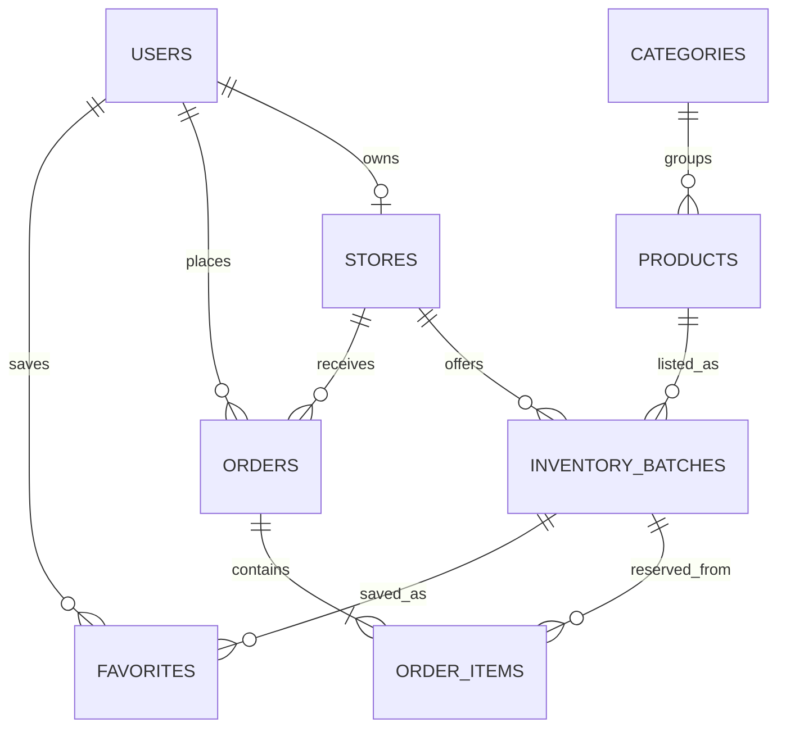

# ObalAi жобасының аралық есебі

**Күні:** 2026 жылғы 12 қараша

**Жоба:** ObalAi — жарамдылық мерзімі жақындаған өнімдерді жеңілдікпен ұсыну және брондау платформасы
**Есептің мәртебесі:** аралық прогресс; қорытынды тапсыру есебі емес

## 1. Жобаның мақсаты

ObalAi дүкендер мен тамақтану орындарына сатылмай қалуы мүмкін, жарамдылық мерзімі жақындаған тауарлар мен дайын тағамдарды жеңілдікпен ұсынуға көмектеседі. Сатып алушы ұсыныстарды қарап, салыстырып, қолжетімді партияны брондайды; сатушы броньды өңдейді. Жоба мақсаты — тағам қалдығын азайтып, сатып алушыға қолжетімді ұсыныстар беру.

## 2. Қазіргі орындалған жұмыс

| Бағыт | Қазіргі нәтиже |
|---|---|
| Репозиторий және сипаттама | GitHub репозиторийі ашылған, қазақ тіліндегі README және даму қағидалары бар. |
| Дерекқор моделі | PostgreSQL үшін сегіз негізгі кестенің SQLAlchemy модельдері мен бастапқы Alembic миграциясы дайындалған. |
| Жергілікті PostgreSQL | PostgreSQL 18 орнатылған, `obalai` дерекқоры құрылған. `0001_initial_marketplace` схемасы осы жергілікті дерекқорға қолданылған. |
| Backend API | FastAPI-де `/health`, тіркелу, кіру және ағымдағы пайдаланушыны алу маршруттары бар. |
| Құпия деректер | PostgreSQL паролі мен JWT құпия кілті жергілікті `backend/.env` файлында сақталады; файл Git арқылы жіберілмейді. |
| Қосылуды тексеру | `/health` жауабы `status: ok`, `database: connected` болып, backend-тің нақты PostgreSQL-ге қосылғанын көрсетті. |
| Кодты GitHub-та сақтау | Модельдер мен миграция `codex/postgres-models-migrations` тармағындағы PR #3 ішінде. PR әлі `main` тармағына қосылған жоқ; GitHub-та автоматты тексерістер де, тәуелсіз ревью де жоқ. |

### Қазіргі дерекқор кестелері

`users`, `stores`, `categories`, `products`, `inventory_batches`, `favorites`, `orders`, `order_items`. Alembic қолданылған ревизияны `alembic_version` кестесінде тіркейді.

Негізгі байланыстар: пайдаланушының дүкені мен тапсырыстары болады; дүкен және тауар партияларды байланыстырады; тапсырыс позициялары нақты партияларға сілтейді; таңдаулылар пайдаланушы мен партияны байланыстырады. Ақша сомалары KZT-пен, уақыт мәндері `TIMESTAMPTZ` арқылы сақталады.



## 3. API және авторизация қалай жұмыс істейді

Қазіргі жергілікті байланыс:

```text
Клиент (жоспарда: PySide6) → FastAPI API → SQLAlchemy → PostgreSQL
```

- `GET /health` — API мен дерекқор байланысын тексереді.
- `POST /api/auth/register` — email және құпиясөзбен аккаунт ашады; әдепкі рөл — `buyer`.
- `POST /api/auth/login` — құпиясөзді тексеріп, уақытша JWT токенін береді.
- `GET /api/auth/me` — токен арқылы ағымдағы пайдаланушыны қайтарады.

`/docs` — FastAPI автоматты жасайтын әзірлеуші құралы. Ол дайын сайт немесе жария демо емес. Қазір backend `127.0.0.1:8000` мекенжайында тек осы компьютерден ашылады; оны басқа адамға жіберу оның компьютеріне қолжетімділік бермейді.

## 4. Әзірге дайын емес бөліктер

- Жария URL-і бар браузерлік демо-сайт жоқ.
- PySide6 пайдаланушы интерфейсі әлі жасалмаған.
- Дүкен құру, сатушының партия жариялауы, каталогтан іздеу, сатып алушының брондауы және сатушының тапсырысты өңдеуі API-де әлі іске асырылмаған.
- WSM алгоритмі мен оның салмақтары құжатталған, бірақ пайдаланушыға арналған API/UI сценарийіне әлі қосылмаған.
- Gemini немесе Gemma модельдері қосылмаған; провайдер, іске қосу тәсілі және қолжетімді квота әлі таңдалмаған.
- Онлайн төлем провайдері қосылмаған; демо тапсырысты «төленді» деп көрсетуге болмайды.
- Backend пен дерекқор жалпыға ашық серверге орналастырылмаған.

## 5. Келесі жұмыс кезеңдері

1. **Дерекқор PR-ын қарау және біріктіру:** модельдер мен миграцияны командамен келісіп `main` тармағына қосу.
2. **Негізгі API сценарийі:** сатушы профилі/дүкені → тауар партиясын жариялау → сатып алушының іздеуі → бір дүкеннен брондау → сатушының тапсырысты өңдеуі. Брондау және қалдықты өзгерту PostgreSQL транзакциясында орындалуы керек.
3. **Клиент интерфейсін нақтылау:** жобаның негізгі өнімі PySide6 desktop-қосымшасы бола ма, әлде оқытушыға сілтеме беретін браузерлік демо да жасала ма — осы шешімді бекіту.
4. **AI/ұсынымдар:** тек нақты тапсырыстар, партиялар және әрекеттер жиналғаннан кейін Gemini/Gemma нұсқаларын бағалау. Дерек жеткіліксіз болса, `insufficient_data` күйін қайтару; танымалдықты есептелген жеке ұсыныс деп атамау.
5. **Жария демо:** API-ді HTTPS бар хостқа, PostgreSQL-ді серверлік ортаға орналастырып, интерфейсті сол API URL-іне қосу. Құпия мәндер сервер ортасында сақталуы керек; PostgreSQL порты көпшілікке ашылмайды.
6. **Сценарийді тексеру:** тіркелу → партияны жариялау → іздеу → брондау → тапсырысты өңдеу жолын нақты дерекпен тексеру.

## 6. Команда және жұмыс қағидалары

Жұмыс екі қатысушы арасында функциялар бойынша бөлінеді; команда мүшелері тек «frontend» және «backend» болып бөлінбейді. API интеграциясын бұрынғы тәжірибесіне байланысты Айдана үйлестіреді. Бір міндеттің қайталанбауы үшін өзгерістерді біріктірмес бұрын тармақ пен Pull Request арқылы үйлестіру керек.

SQLite қолданылмайды. Жалған табысты жауаптар мен жасанды AI/тапсырыс деректері нақты интеграцияның орнына қойылмайды. Төлем тек нақты провайдер қосылғаннан кейін іске асырылады.

## 7. Репозиторий және демо сілтемелері

- **GitHub:** [https://github.com/heewonenn/ObalAI](https://github.com/heewonenn/ObalAI)
- **Дерекқор модельдері мен миграциясы:** [PR #3](https://github.com/heewonenn/ObalAI/pull/3)
- **Жария демо:** әзірге жоқ; `localhost` мекенжайы сыртқы пайдаланушыларға жарамайды.

Репозиторийдің көріну күйі — жеке (`private`). Мұғалімге сілтеме арқылы кіру үшін репозиторийді ашық ету немесе мұғалімнің GitHub аккаунтын collaborator ретінде шақыру қажет.
